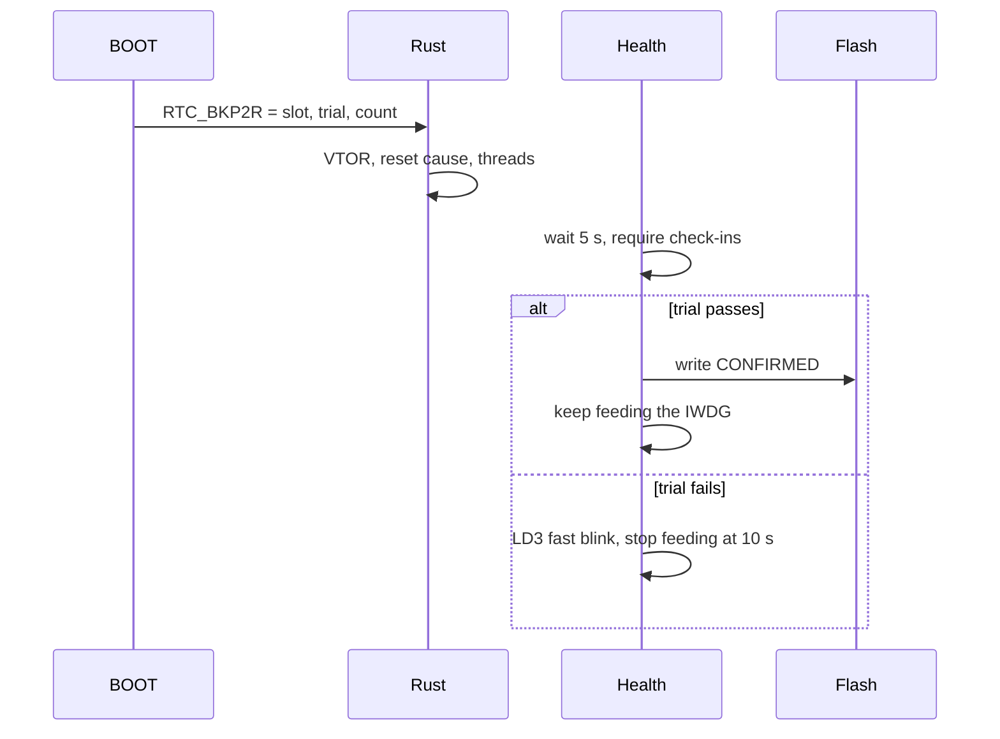

# Architecture

This page describes how `app-rust-zephyr` combines Zephyr's Rust module with a
small C glue layer. It covers the thread model, the devicetree overlay, the
flash and boot contract, the remaining C responsibilities and an honest list of
what works and what does not yet.

## Layers

```text
┌──────────────────────────────────────────────────────────────┐
│ Rust application (src/, librustapp.a)                        │
│   app/health, app/comms, app/button, app/led                 │
│   app/ipc, app/fault, app/identity                           │
│   protocol/hwlink (COBS, CRC-32, FlatBuffers)                │
├──────────────────────────────────────────────────────────────┤
│ FFI: extern "C" functions in platform/platform.h             │
├──────────────────────────────────────────────────────────────┤
│ C glue (platform/)                                           │
│   platform.c: GPIO, UART3, flash, watchdog, fault, reboot    │
│   debug_log.c: USART6 line format and Zephyr log integration │
├──────────────────────────────────────────────────────────────┤
│ Zephyr 4.4.2, the lang/rust module and the STM32 HAL          │
└──────────────────────────────────────────────────────────────┘
```

The application logic is Rust. The C layer is intentionally thin: it holds the
Zephyr driver calls that the pinned Rust bindings do not reach, plus the
`__noinit` fault record and the fatal handler. `platform/platform.h` is the
only boundary; there is no C application logic.

## Thread model

The four threads are created by the `zephyr` crate's `#[zephyr::thread]`
attribute, so stack sizes and priorities are compile-time constants in
`src/lib.rs` and the thread bodies are ordinary Rust functions.

| Thread | Priority | Stack | Responsibility |
|---|---:|---:|---|
| Health | 2 | 2048 B | check-ins, watchdog feed, trial check and `CONFIRMED` |
| Comms | 3 | 4096 B | USART3, HWLINK framing, FlatBuffers commands and replies |
| Button | 4 | 1536 B | B1 debounce, short and long press classification |
| LED | 5 | 1536 B | LD1/LD2/LD3 patterns and the LD3 status display |

Health is the only watchdog feeder and the only writer of the `CONFIRMED`
record. The LED thread is the only writer of the LED pins. The other threads
check in with Health; a check-in older than 2 s fails the health test. The
`CONFIG_ZDEMO_FAIL_HEALTH` equivalent is `CONFIG_RZDEMO_FAIL_HEALTH` (see
`Kconfig`).

## Devicetree overlay

`boards/nucleo_f767zi.overlay` replaces the stock MCUboot partition layout with
the project bootloader layout:

```dts
&flash0 {
    partitions {
        boot_partition: partition@0      { reg = <0x00000000 0x00008000>; };
        app_meta_partition: partition@8000 { reg = <0x00008000 0x00004000>; };
        slot0_partition: partition@c000   { reg = <0x0000c000 0x000f4000>; };
    };
};
```

It also moves the console and log output to USART6 and leaves USART3 for
HWLINK. `boards/dt-rust.yaml` is a local copy of the Zephyr Rust module's
devicetree augments with the STM32 flash controller added; the pinned module
does not list `st,stm32-flash-controller` itself. The build asserts
`CONFIG_FLASH_LOAD_OFFSET` and `CONFIG_FLASH_LOAD_SIZE` in
`platform/platform.c`, so a mismatch between the overlay and the bootloader
layout fails at compile time.

## Flash and RAM map

BOOT swaps the two 1 MB flash banks, so the image linked at `0x0800C000` runs
from slot A or B without a rebuild.

| Address | Size | Use |
|---|---:|---|
| `0x08000000` | 32 KB | BOOT, sectors 0..1 |
| `0x08008000` | 16 KB | metadata sector for the running slot |
| `0x0800C000` | 976 KB | application slot / running image |
| `0x08108000` | 16 KB | metadata sector for the other slot |
| `0x0810C000` | 976 KB | application slot in bank 2 |

The application writes only the 32-byte `CONFIRMED` record at offset `0x140`
of the metadata sector, through `plat_confirmed_write()` and the Zephyr flash
API. The fault record lives in a `__noinit` section and survives a reset.

## Boot hand-over

1. BOOT writes the hand-over word to `RTC_BKP2R`: magic, slot, trial-pending
   bit and trial counter, then maps the active bank and jumps to the image.
2. Zephyr's Rust `main.c` calls `rust_main()`. Rust bumps the fault boot id,
   feeds the watchdog BOOT started, captures the reset cause and decodes the
   hand-over word.
3. `rust_main()` checks `VTOR`, starts Health, Comms, Button and LED, and
   returns. The Zephyr kernel keeps running the threads.
4. On a pending slot, Health waits five seconds, checks the thread check-ins
   and writes `CONFIRMED`. On failure it stops feeding the watchdog after ten
   seconds so BOOT rolls back.

`EnterBootloader` asks BOOT to stay in update mode through `RTC_BKP1R`, sends
the Ack and resets.



## What stays in C, and why

| C file | Responsibility | Why not Rust yet |
|---|---|---|
| `platform/platform.c` | GPIO, UART3, flash, watchdog, reboot, stack info | The pinned `zephyr` crate bindings do not expose every driver API used here (watchdog install/feed, flash partition write, UART runtime baud change, stack high-water) |
| `platform/platform.c` | `__noinit` fault record and fatal hook | Needs the linker section and Zephyr's fatal handler, which the Rust module does not wrap |
| `platform/debug_log.c` | USART6 line format and Zephyr log backend | Keeps the exact demo log format shared with the C versions; moving it would duplicate Zephyr's log backend configuration in Rust |
| `platform/platform.c` | `plat_confirmed_read/write` | The flash write is the bootloader contract; keeping it next to the boot constants makes the contract reviewable in one place |

Each row is a candidate for removal when the upstream `zephyr` crate grows the
corresponding safe binding. The wrapper names and the header are the migration
surface.

## What works and what does not yet

| Area | Status |
|---|---|
| Rust application threads | Works: Health, Comms, Button, LED |
| HWLINK framing and FlatBuffers | Works: same schema and behaviour as the other four repos |
| LEDs, button, watchdog, trial confirmation | Works on the NUCLEO-F767ZI |
| Host tests for the protocol | Works: `make test-host` |
| `ztest` for the C glue | Not yet: the glue needs a Zephyr test image and a native_sim board config |
| `native_sim` build of this app | Not yet: the app is configured for the STM32 board and USART3/USART6 overlay |
| Rust access to every driver | Not yet: see the C layer table above |
| `defmt` / RTT | Not yet: the debug path is USART6, as in the C demos |

## Devicetree augment limitation

`boards/dt-rust.yaml` keeps the upstream TODO about read/write/erase
properties: the pinned `zephyr-build` revision builds a flash partition
instance from `reg` only and does not read those properties. The flash driver
still reports the real geometry at run time, so this is a metadata gap rather
than a functional one. The local copy exists only to add the STM32 flash
controller compatible; it can be deleted when the pinned module lists it.

## Reproducibility

The toolchain is pinned in two layers, both from the repository:

- `docker/Dockerfile.zephyr` pins Zephyr (`ZEPHYR_VERSION=v4.4.2`) and the
  Zephyr SDK (`ZEPHYR_SDK_VERSION=1.0.1`).
- The child `docker/Dockerfile` pins `zephyr-lang-rust` at
  `ZEPHYR_RUST_REVISION=dd73abc...` (the revision in Zephyr's
  `submanifests/optional.yaml`) and the Rust toolchain at
  `RUST_VERSION=1.99.1`.

`rust-toolchain.toml` repeats the Rust version, so a host build outside the
container either uses the same toolchain or fails early.

## Build and quality gates

| Target | What it checks |
|---|---|
| `make build` | Zephyr + Cargo build, image header, footprint |
| `make lint` | the single lint entry point: rustfmt and clippy (see `scripts/lint.sh`) |
| `make test-host` | HWLINK framing tests on the host |
| `make boot-contract` | slot and metadata constants against the BOOT layout |
| `make image-check` | image magic, load address, CRC and reset vector |
| `cargo audit` / `cargo deny` | dependency advisories, licences and sources |

`make lint` is the documented entry point; `scripts/lint.sh` is its
implementation and is not meant to be called directly. The script extracts the
module's own cargo command from `build/build.ninja`, so clippy sees the same
`DOTCONFIG`, include paths and `zephyr`/`zephyr-sys` path dependencies as the
build.

## Where to look

| Topic | Source |
|---|---|
| Entry point and thread constants | `src/lib.rs` |
| Threads | `src/app/{health,comms,button,led}.rs` |
| FFI wrappers | `src/platform/plat.rs` |
| C glue | `platform/platform.c`, `platform/debug_log.c` |
| Devicetree | `boards/nucleo_f767zi.overlay`, `boards/dt-rust.yaml` |
| Boot contract | `src/platform/board.rs`, `src/platform/boot.rs` |
| Protocol | `src/protocol/hwlink/` |
| Host protocol tests | `protocol/hwlink-tests/` |
